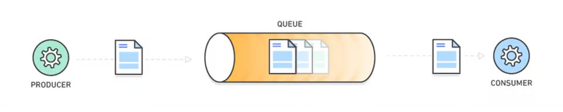
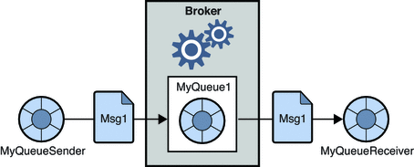
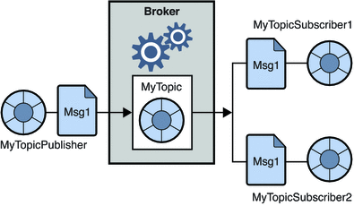

# Tuần 4: Message Queue — Lý thuyết

## 1. Tìm hiểu Message Queue

### 1.1. Message Queue là gì?

**Message Queue (MQ)** là hàng đợi lưu các thông điệp để các thành phần trong hệ thống trao đổi dữ liệu và xử lý công việc bất đồng bộ. Bên gửi đưa message vào hệ thống hàng đợi; bên nhận xử lý sau, không yêu cầu bên gửi chờ hoàn tất nghiệp vụ.



Các khái niệm cơ bản:

| Thành phần | Vai trò |
|---|---|
| Producer | Tạo và gửi message |
| Message | Dữ liệu mô tả công việc hoặc sự kiện, ví dụ yêu cầu gửi email hoặc sự kiện đơn hàng được tạo |
| Queue | Giữ message chờ xử lý |
| Consumer | Nhận message và thực hiện nghiệp vụ |
| Broker | Hệ thống trung gian quản lý việc nhận, lưu trữ và chuyển giao message |

Producer và consumer cần thống nhất cấu trúc dữ liệu và ý nghĩa của message. Ví dụ một message dạng JSON do ứng dụng định nghĩa:

```json
{
  "eventId": "evt-001",
  "eventType": "OrderCreated",
  "orderId": 123
}
```

### 1.2. Tại sao cần MQ?

Xét bài toán: sau khi đặt hàng, hệ thống cần gửi email, cập nhật kho và ghi log. Nếu API gọi tuần tự và chờ từng bước:

```text
Client → API đặt hàng → Lưu đơn → Cập nhật kho → Gửi email → Ghi log → Response
```

Thời gian phản hồi cộng dồn từ các bước. Nếu gửi email lỗi và API không xử lý lỗi riêng, request có thể báo lỗi dù đơn hàng đã được lưu. Việc một bước lỗi có làm cả luồng thất bại hay không phụ thuộc cách tổ chức transaction và xử lý lỗi, không phải đặc tính bắt buộc của giao tiếp đồng bộ.

MQ cho phép tách các công việc có thể làm sau sang consumer:

```text
Client → API đặt hàng → Xử lý nghiệp vụ chính → Publish sự kiện → Response
                                                    ↓
                                            Hạ tầng messaging
                                             ├→ Xử lý email
                                             ├→ Xử lý kho
                                             └→ Ghi log
```

*Sơ đồ thể hiện mô hình nhiều nhóm nhận sự kiện; cơ chế cụ thể được giải thích ở phần 2.*

API không chờ mọi tác vụ phía sau hoàn tất. Tuy nhiên, nếu cần đảm bảo còn hàng mới chấp nhận đơn, phải thiết kế bước kiểm tra/giữ hàng trong luồng nghiệp vụ chính hoặc quản lý trạng thái đơn đang chờ xác nhận; không chuyển trừ kho sang xử lý sau một cách máy móc.

Những lợi ích thường gặp:

- **Tách rời thành phần:** bên gửi không phải gọi trực tiếp từng bên xử lý.
- **Xử lý nền:** giảm thời gian API chờ các tác vụ như gửi email hoặc tạo báo cáo.
- **Đệm tải:** giữ các message đã tiếp nhận để consumer xử lý theo năng lực.
- **Chia tải:** tăng số worker khi cần xử lý nhiều công việc hơn.

MQ cũng tăng chi phí vận hành và theo dõi lỗi. Hàng đợi có giới hạn tài nguyên; khả năng giữ và giao lại message phụ thuộc công nghệ, cấu hình và cách ứng dụng xử lý xác nhận. Không thể mặc định dùng MQ là không mất dữ liệu.

### 1.3. Sync và Async communication

| Tiêu chí | Đồng bộ (Sync) | Bất đồng bộ qua MQ (Async) |
|---|---|---|
| Cách trao đổi | Bên gọi chờ kết quả từ bên được gọi | Bên gửi gửi message, bên nhận xử lý độc lập |
| Thời điểm nhận kết quả nghiệp vụ | Trong lượt gọi nếu xử lý thành công | Có thể sau khi bên gửi đã tiếp tục công việc |
| Khi bên nhận chậm | Bên gọi có thể phải chờ hoặc timeout | Message có thể chờ trong hàng đợi |
| Xử lý lỗi | Thường phản ánh qua lỗi/timeout của lượt gọi | Cần theo dõi kết quả, retry và xử lý message lỗi |
| Ví dụ | Kiểm tra mật khẩu để cấp token | Gửi email chào mừng sau đăng ký |

Async không có nghĩa mọi thao tác đều không phải chờ. Producer vẫn có thể phải chờ thao tác gửi hoặc xác nhận tiếp nhận từ broker; đó là việc khác với chờ consumer hoàn tất nghiệp vụ.

Dữ liệu giữa các thành phần có thể được cập nhật ở các thời điểm khác nhau, dẫn đến **nhất quán cuối cùng (eventual consistency)**. Điều này không làm mất khả năng dùng transaction ACID bên trong từng service.

### 1.4. Khi nào dùng MQ, khi nào gọi trực tiếp?

| Tình huống | Hướng lựa chọn | Lý do |
|---|---|---|
| Gửi email, xử lý ảnh, xuất báo cáo | MQ | Có thể hoàn tất sau và cần worker xử lý |
| Lưu lượng công việc tăng đột biến | MQ | Cần đệm tải và điều tiết tốc độ xử lý |
| Nhiều thành phần phản ứng với một sự kiện | Pub/Sub | Mỗi nhóm thực hiện một nghiệp vụ độc lập |
| Đăng nhập, cần kết quả kiểm tra mật khẩu | Gọi trực tiếp | Cần kết quả để quyết định cấp token |
| Đọc thông tin sản phẩm để hiển thị ngay | Gọi trực tiếp | Client cần dữ liệu trong lượt request |
| Tác vụ đơn giản, tải thấp | Cân nhắc gọi trực tiếp | Giảm chi phí hạ tầng và độ phức tạp |

MQ phù hợp khi có nhu cầu xử lý nền hoặc tách thành phần rõ ràng. Monolith cũng có thể dùng MQ; không bắt buộc phải có microservices.

## 2. Các mô hình Message Queue

### 2.1. Point-to-Point (Queue)

Trong mô hình **Point-to-Point**, các consumer cùng nhận việc từ một queue. Mỗi lần giao message hướng tới một consumer trong nhóm, thay vì phát cho toàn bộ nhóm.



Ví dụ nhiều worker gửi email cùng đọc một queue:

```text
Producer → Queue email ─┬→ Worker A nhận message 1
                       ├→ Worker B nhận message 2
                       └→ Worker C nhận message 3
```

Đặc điểm:

- Có thể có nhiều producer và nhiều consumer; cách gọi “1:1” mô tả việc giao một message tới một bên xử lý, không giới hạn số ứng dụng kết nối.
- Các consumer chia nhau công việc để tăng khả năng xử lý.
- Nếu có lỗi và giao lại message, cùng một công việc có thể được nhận nhiều lần. Mô hình này không tự đảm bảo exactly-once processing.

**Khi dùng:** các worker làm cùng loại công việc, ví dụ gửi email, xử lý ảnh hoặc tạo báo cáo. Thêm worker nhằm chia tải, không tạo thêm các bước nghiệp vụ khác nhau.


### 2.2. Publish/Subscribe (Topic)

Trong mô hình **Publish/Subscribe (Pub/Sub)**, publisher phát message hoặc sự kiện tới một chủ đề/điểm phát. Hạ tầng messaging chuyển sự kiện tới các subscription phù hợp.



Ví dụ sự kiện đơn hàng được tạo:

```text
Publisher → Chủ đề OrderCreated ─┬→ Subscription email → Gửi email
                                ├→ Subscription kho   → Xử lý kho
                                └→ Subscription log   → Ghi log
```

Đặc điểm:

- Các nhóm đăng ký phù hợp có thể cùng nhận một sự kiện để thực hiện những nghiệp vụ khác nhau.
- Publisher không cần gọi trực tiếp từng subscriber.
- Một subscription có thể có nhiều worker chia tải; không đồng nghĩa mọi worker trong subscription đều nhận một bản sao.
- Khả năng nhận lại khi subscriber offline hoặc đọc lại sự kiện cũ phụ thuộc công nghệ và cấu hình lưu trữ, không phải đảm bảo chung của Pub/Sub.

**Khi dùng:** một sự kiện cần kích hoạt nhiều luồng độc lập, như email, kho và thống kê cùng phản ứng với sự kiện đặt hàng.

### 2.3. So sánh và cách lựa chọn

| Tiêu chí | Point-to-Point | Publish/Subscribe |
|---|---|---|
| Mục tiêu | Phân phối công việc giữa các worker | Phát sự kiện tới nhiều nhóm quan tâm |
| Bên nhận | Một consumer cho mỗi lần giao trên queue | Nhiều subscription phù hợp cùng nhận sự kiện |
| Vai trò các nhóm xử lý | Các worker thường làm cùng loại công việc | Các nhóm có thể làm nghiệp vụ khác nhau |
| Ví dụ | Ba worker chia nhau gửi email | Email, kho và thống kê cùng nhận sự kiện đặt hàng |

Hai mô hình có thể kết hợp: phát một sự kiện tới nhiều subscription, rồi dùng nhiều worker chia tải trong từng subscription.

Cần tách biệt **phát cùng sự kiện cho nhiều nhóm** với **chia việc cho nhiều worker trong một nhóm**. Các khái niệm cụ thể để triển khai bằng RabbitMQ sẽ được trình bày ở phần 3 theo README.

## 3. Chọn 1 Message Queue & tìm hiểu kiến trúc

### 3.1. Lựa chọn RabbitMQ

Trong bài thực hành này, chọn **RabbitMQ** làm message broker để triển khai giao tiếp bất đồng bộ giữa API và consumer.

RabbitMQ nhận message từ producer, định tuyến tới queue và chuyển tới consumer. Công việc nghiệp vụ như gửi email do consumer thực hiện, không phải broker tự xử lý.

**Lý do lựa chọn cho bài thực hành:**

- Phù hợp với luồng đăng ký tài khoản → gửi email chào mừng ở nền.
- Có thể thực hành cả chia tải qua một queue và phát sự kiện tới nhiều queue.
- Có Docker image và Management UI để quan sát exchange, queue, binding và trạng thái message.

Phần kiến trúc dưới đây sử dụng mô hình **AMQP 0-9-1**, một giao thức RabbitMQ hỗ trợ.

### 3.2. Kiến trúc và các thành phần chính


*Các số trong hình tương ứng các bước của luồng message.*

| Thành phần | Vai trò | Ví dụ trong bài thực hành |
|---|---|---|
| Producer / Publisher | Ứng dụng tạo và gửi message | API đăng ký tài khoản |
| Message | Dữ liệu mô tả một sự kiện hoặc yêu cầu | Sự kiện `UserRegistered` |
| Exchange | Nhận message từ producer và định tuyến | `user.events` |
| Queue | Giữ message chờ consumer xử lý | `email.welcome` |
| Consumer | Nhận message từ queue và thực hiện nghiệp vụ | Worker gửi email chào mừng |
| Binding | Quy tắc liên kết exchange với queue | Liên kết `user.events` → `email.welcome` |
| Routing key | Khóa producer gửi kèm để phục vụ định tuyến | `user.registered` |

Đọc luồng trong hình theo thứ tự:

1. Producer publish message tới exchange.
2. Exchange xác định cách định tuyến dựa trên loại exchange và thông tin message.
3. Các binding xác định những queue phù hợp.
4. Message được đưa vào queue để chờ giao.
5. Consumer nhận message và xử lý.

Exchange có thể định tuyến tới không, một hoặc nhiều queue. Producer gửi tới **exchange**; consumer nhận từ **queue**. Hai binding trong hình không có nghĩa mọi message đều luôn được gửi tới cả hai queue.

Một số khái niệm kết nối:

- **Connection:** kết nối mạng giữa ứng dụng và broker.
- **Channel:** kết nối logic bên trong connection, dùng để publish, consume và xác nhận message. Nhiều channel có thể dùng chung connection; connection đóng thì các channel bên trong cũng đóng.
- **Virtual host (vhost):** không gian phân tách tài nguyên và quyền truy cập. Ví dụ `/training` chứa các exchange và queue của bài thực hành.

### 3.3. Exchange và cách định tuyến


*Ảnh minh họa từ CloudAMQP. Direct, Topic và Fanout là các lựa chọn định tuyến, không phải ba bước message phải đi qua lần lượt.*

| Loại exchange | Nguyên tắc | Ví dụ |
|---|---|---|
| Direct | Routing key khớp chính xác binding key | `user.registered` |
| Fanout | Gửi bản sao tới mọi queue đã bind, bỏ qua routing key | Email và thống kê cùng nhận sự kiện |
| Topic | Khớp routing key theo mẫu | `user.*`, `user.#` |
| Headers | Khớp các điều kiện trên message headers | `format=json`, `type=report` |

Với topic exchange, `*` khớp đúng một đoạn và `#` khớp không hoặc nhiều đoạn, phân cách bằng dấu `.`. Ví dụ `user.*` khớp `user.registered` nhưng không khớp `user.email.changed`.

Bài thực hành chọn **direct exchange** để định tuyến rõ ràng sự kiện đăng ký tới queue email:

```text
Exchange: user.events
Binding key: user.registered
Queue: email.welcome
```

Producer gửi routing key `user.registered` thì binding này khớp. Nếu có nhiều queue cùng bind khóa đó, chúng đều có thể nhận message; direct không giới hạn chỉ một queue nhận.

Trong RabbitMQ, consumer đăng ký nhận từ queue. **Topic exchange** là bộ định tuyến theo mẫu, không phải nơi consumer đọc trực tiếp như cách thường hình dung về một topic lưu sự kiện.

### 3.4. Kiến trúc dự kiến cho bài thực hành

```text
Client → API đăng ký → Lưu user → Publish UserRegistered → Trả response
                                          │
                                          ▼
                              Direct exchange: user.events
                              Routing key: user.registered
                                          │
                              Binding key: user.registered
                                          ▼
                                  Queue: email.welcome
                                          │
                                          ▼
                               Consumer gửi email → ACK
```

API hoàn tất nghiệp vụ chính và bước gửi sự kiện theo thiết kế rồi phản hồi, không chờ gửi email xong. Consumer xử lý email riêng và xác nhận sau khi hoàn tất phần việc cần đảm bảo.

Nếu tăng số worker cùng đọc `email.welcome`, các worker chia nhau công việc. Nếu muốn thêm nhóm thống kê cũng nhận sự kiện, cần queue riêng và binding phù hợp.

Kiến trúc này đã được triển khai trong backend và được trình bày ở phần 4. Các vấn đề về mất message, message trùng, retry và thứ tự xử lý được phân tích ở phần 5.

### 3.5. Cài đặt RabbitMQ bằng Docker Compose

RabbitMQ được khai báo thành service riêng trong [backend/compose.yaml](./backend/compose.yaml), cùng Compose project `training-typ` với PostgreSQL. Mỗi service có container và volume dữ liệu riêng:

```text
training-typ                  ← Compose project trên Docker Desktop
├── postgres-1                ← Container PostgreSQL
└── rabbitmq-1                ← Container RabbitMQ
```

Tên hiển thị cụ thể có thể có thêm tiền tố project. Nhóm `training-typ` không phải một container chứa cả hai dịch vụ.

Các lệnh `docker compose` dưới đây chạy trong **thư mục `week-4/backend` chứa `compose.yaml`**. Mở terminal tại thư mục này trong IDE, hoặc nếu đang ở thư mục gốc repository thì chạy:

```powershell
Set-Location .\week-4\backend
```

Nếu chạy ở thư mục khác, cần chỉ định file bằng `-f`, ví dụ: `docker compose -f "D:\Code\trainning-typ-2026\week-4\backend\compose.yaml" up -d rabbitmq`.

Mật khẩu mặc định chỉ dành cho lab. Các ảnh dưới đây ghi lại kết quả tải image, chạy container, đăng nhập giao diện quản trị và tạo topology minh họa.

#### Bước 1: Chuẩn bị cấu hình Compose

Mở Docker Desktop và chờ Docker Engine sẵn sàng với Linux containers. File `compose.yaml` của bài thực hành có nội dung:

```yaml
name: training-typ

services:
  postgres:
    image: postgres:17-alpine
#    container_name: backend-typ-postgres
    environment:
      POSTGRES_DB: backend-typ
      POSTGRES_USER: backend-typ
      POSTGRES_PASSWORD: ${POSTGRES_PASSWORD:-password}
    ports:
      - "5432:5432"
    volumes:
      - backend-typ-postgres-data:/var/lib/postgresql/data

  rabbitmq:
    image: rabbitmq:4.4.0-management
    hostname: training-typ-rabbitmq
    environment:
      RABBITMQ_DEFAULT_USER: training
      RABBITMQ_DEFAULT_PASS: ${RABBITMQ_PASSWORD:-training-local-password}
      RABBITMQ_DEFAULT_VHOST: /training
    ports:
      - "127.0.0.1:5672:5672"
      - "127.0.0.1:15672:15672"
    volumes:
      - backend-typ-rabbitmq-data:/var/lib/rabbitmq
    healthcheck:
      test: ["CMD", "rabbitmq-diagnostics", "-q", "check_running"]
      interval: 10s
      timeout: 5s
      retries: 6
      start_period: 30s

volumes:
  backend-typ-postgres-data:
  backend-typ-rabbitmq-data:
```

| Cấu hình RabbitMQ | Ý nghĩa |
|---|---|
| `image: rabbitmq:4.4.0-management` | Pin phiên bản; có Management UI |
| Service `rabbitmq` | Tên dùng với Compose CLI và DNS trong mạng Compose |
| `hostname` | Hostname ổn định cho broker |
| `RABBITMQ_DEFAULT_*` | Khởi tạo user, password và vhost trên dữ liệu mới |
| `${RABBITMQ_PASSWORD:-training-local-password}` | Dùng biến môi trường nếu có, nếu không dùng mật khẩu lab |
| Port `5672` | AMQP cho backend |
| Port `15672` | HTTP Management UI |
| `127.0.0.1` | Công bố các cổng trên loopback của máy host |
| `backend-typ-rabbitmq-data` | Named volume riêng lưu dữ liệu RabbitMQ |
| `healthcheck` | Kiểm tra ứng dụng RabbitMQ đang chạy bằng `check_running` |

User/vhost mặc định chỉ được khởi tạo khi dữ liệu còn mới. Đổi biến môi trường không tự đổi mật khẩu user đã có trong volume. Volume không thay thế backup. 


#### Bước 2: Tải image RabbitMQ

```powershell
docker compose pull rabbitmq
```

Compose tải image đã khai báo cho service `rabbitmq`. Kết quả thực hiện hiển thị image `rabbitmq:4.4.0-management` ở trạng thái **Pulled**.


#### Bước 3: Khởi động RabbitMQ trong project

```powershell
docker compose up -d rabbitmq
```

Lệnh trên tạo/khởi động service RabbitMQ. Nếu muốn khởi động cả PostgreSQL và RabbitMQ:

```powershell
docker compose up -d
```

Trên Docker Desktop, mở nhóm `training-typ` để xem từng container. Compose tạo mạng mặc định để các service trong project liên lạc với nhau.

#### Bước 4: Kiểm tra broker

```powershell
docker compose ps
```

Chờ RabbitMQ chuyển sang `healthy` theo healthcheck đã cấu hình. Nếu khởi động lỗi, xem log bằng `docker compose logs rabbitmq`. Demo publish/consume sẽ thực hiện ở phần 4.


*Docker Desktop hiển thị `postgres-1` và `rabbitmq-1` trong cùng nhóm `training-typ`. Tại thời điểm chụp, RabbitMQ đang chạy, còn PostgreSQL đang dừng. Ảnh này xác nhận trạng thái chạy của container, không thể hiện kết quả healthcheck.*

#### Bước 5: Mở Management UI

Truy cập `http://localhost:15672` và đăng nhập bằng tài khoản đã khai báo trong Compose:

| Thông tin | Giá trị |
|---|---|
| Username | `training` |
| Password lab | `training-local-password` (hoặc giá trị `RABBITMQ_PASSWORD` đã đặt khi khởi tạo) |
| Vhost sử dụng | `/training` |

Trong giao diện, chọn hoặc lọc đúng vhost `/training`. Các trang cần nhận biết:

- **Overview:** tổng quan broker.
- **Exchanges:** các exchange và cấu hình định tuyến.
- **Queues and Streams:** queue, số message và consumer.
- **Connections / Channels:** kết nối từ ứng dụng.


*Giao diện tại `localhost:15672` hiển thị RabbitMQ 4.4.0 và user `training`. Ảnh được chụp trước khi tạo queue, nên số queue và consumer đều bằng 0. Bộ lọc Virtual host đang để `All`; khi thao tác cần chọn đúng `/training`.*

#### Bước 6: Kiểm tra topology minh họa trên UI

Để đối chiếu kiến trúc với giao diện, tạo các tài nguyên mẫu sau trong vhost `/training`:

1. Tạo exchange `user.events`, loại **direct**, durable bật.
2. Tạo queue `email.welcome`, loại **classic**, durable bật, auto-delete tắt.
3. Tạo binding từ `user.events` tới `email.welcome`, routing/binding key là `user.registered`.

Đây là topology lab một node để học routing. Durable queue giữ định nghĩa qua restart, không tự đảm bảo mọi message không mất. Khi phần 4 khai báo topology bằng code, tên, loại và thuộc tính phải tương thích với tài nguyên đã có.


*Exchange `user.events` có loại `direct`, `durable: true` và binding tới `email.welcome` với key `user.registered`, khớp với kiến trúc đã mô tả.*


*Queue `email.welcome` có loại `classic`, `durable: true`; phần Bindings hiển thị liên kết từ `user.events` với key `user.registered`. Tại thời điểm chụp, Ready, Unacked và Consumers đều bằng 0, tương ứng queue chưa có message chờ xử lý và chưa có consumer đăng ký.*

Các ảnh xác nhận broker và topology mẫu đã được tạo. Luồng gửi message từ API và consumer xử lý email được trình bày ở phần 4.

### 3.6. Thông tin kết nối cho phần triển khai

| Thông số | Giá trị theo hướng dẫn Docker Compose |
|---|---|
| Host khi backend chạy trên máy host | `localhost` |
| Host khi backend cùng mạng Compose | `rabbitmq` |
| Port AMQP | `5672` |
| Username | `training` |
| Password lab | `training-local-password` (hoặc giá trị `RABBITMQ_PASSWORD` đã đặt khi khởi tạo) |
| Virtual host | `/training` |
| Exchange | `user.events` |
| Queue | `email.welcome` |
| Routing key | `user.registered` |

`15672` dành cho UI, không dùng làm cổng AMQP của backend. Backend chạy bằng IDE trên máy host kết nối `localhost:5672`; backend chạy trong cùng mạng Compose kết nối `rabbitmq:5672`. Trong container backend, `localhost` trỏ về chính container đó.

Dừng/khởi động lại riêng RabbitMQ từ thư mục `week-4/backend`:

```powershell
docker compose stop rabbitmq
docker compose start rabbitmq
```

Nếu trước đó đã chạy container RabbitMQ riêng bằng `docker run`, kiểm tra `docker ps` và dừng đúng container cũ nếu nó đang chiếm cổng `5672`/`15672`. Container và volume tạo bằng `docker run` không tự chuyển vào Compose project; không xóa volume PostgreSQL để giải quyết lỗi cổng.

## 4. Implement — Phát triển từ project tuần 2-3

### 4.1. Chức năng đã triển khai

Phát triển tiếp API đăng ký tài khoản: sau khi tạo user thành công, hệ thống phát sự kiện qua RabbitMQ để consumer gửi email chào mừng.

- **Nghiệp vụ chính:** kiểm tra dữ liệu, kiểm tra trùng username/email, mã hóa mật khẩu và lưu user vào PostgreSQL.
- **Tác vụ nền:** consumer nhận sự kiện và gửi email qua SMTP tới Mailpit.
- **Kết quả:** API không phải chờ gửi email xong mới phản hồi. Email trong lab được xem tại Mailpit, không gửi tới hộp thư thật bên ngoài.

Producer và consumer nằm trong cùng backend nhưng trao đổi qua RabbitMQ; controller không gọi trực tiếp hàm gửi email.

### 4.2. Luồng xử lý

```text
Client gọi POST /api/v1/auth/register
             │
             ▼
AuthServiceImpl kiểm tra và lưu user
             │
             ▼
Transaction database commit thành công
             │
             ▼
UserRegisteredPublisher publish sự kiện
             │
             ▼
Exchange user.events → Queue email.welcome
             │                       │
             │                       ▼
             │             WelcomeEmailConsumer
             │                       │
             │                       ▼
             │              WelcomeEmailService
             │                       │
             │                       ▼
             │                 Mailpit SMTP
             │                       │
             │                       ▼
             │             Listener thành công → ACK
             ▼
API phản hồi HTTP 201, không chờ nhánh gửi email hoàn tất
```

Hai nhánh sau khi publish có thể diễn ra đồng thời; consumer không bắt buộc phải chờ client nhận response mới xử lý.

`AuthServiceImpl.register()` có `@Transactional`. Sau `saveAndFlush()`, ứng dụng phát `UserRegisteredEvent` bằng `ApplicationEventPublisher`. Đây là sự kiện nội bộ Spring, chưa phải message đã gửi tới RabbitMQ. `UserRegisteredPublisher` dùng `@TransactionalEventListener(AFTER_COMMIT)` để publish tới broker sau khi transaction thành công, tránh phát sự kiện cho một đăng ký bị rollback.

Producer hiện chờ publisher confirm tối đa **5 giây**, nên API vẫn có thời gian chờ bước publish/xác nhận broker; phần được tách ra xử lý nền là gửi email. Nếu publish lỗi sau commit, code ghi log và không hoàn tác user đã lưu. Vì vậy, HTTP `201` không chứng minh email chắc chắn được gửi; giới hạn này được phân tích ở mục 5.2.

### 4.3. Các thành phần trong source code

Các đường dẫn dưới đây tính từ `backend/src/main/java/vn/xuandat/backend/`:

| File | Trách nhiệm |
|---|---|
| [AuthServiceImpl.java](./backend/src/main/java/vn/xuandat/backend/service/impl/AuthServiceImpl.java) | Lưu user và phát sự kiện nội bộ trong transaction |
| [UserRegisteredEvent.java](./backend/src/main/java/vn/xuandat/backend/messaging/event/UserRegisteredEvent.java) | Message gồm `eventId`, `userId`, `email`, `fullName`, `occurredAt` |
| [RabbitConfig.java](./backend/src/main/java/vn/xuandat/backend/config/RabbitConfig.java) | Khai báo exchange, queue, binding và JSON converter |
| [UserRegisteredPublisher.java](./backend/src/main/java/vn/xuandat/backend/messaging/publisher/UserRegisteredPublisher.java) | Publish sau commit, đánh dấu persistent, kiểm tra confirm và returned message |
| [WelcomeEmailConsumer.java](./backend/src/main/java/vn/xuandat/backend/messaging/consumer/WelcomeEmailConsumer.java) | Nhận sự kiện qua `@RabbitListener` và gọi service gửi email |
| [WelcomeEmailService.java](./backend/src/main/java/vn/xuandat/backend/service/WelcomeEmailService.java) | Dùng `JavaMailSender` gửi email chào mừng |

Topology được khai báo bằng code để ứng dụng tự tạo khi kết nối RabbitMQ; không cần tạo lại thủ công trên Management UI ở mỗi lần chạy. Tài nguyên đã tồn tại phải có cấu hình tương thích với code.

| Thông số | Cấu hình hiện tại |
|---|---|
| Vhost | `/training` |
| Exchange | `user.events`, loại `direct`, durable |
| Routing/binding key | `user.registered` |
| Queue | `email.welcome`, loại `classic`, durable |
| Message | JSON, `message_id` lấy từ `eventId`, delivery mode persistent |
| Consumer ACK | Spring `AUTO` |
| Prefetch | `1` |
| SMTP / giao diện xem email | Mailpit tại `localhost:1025` / `http://localhost:8025` |

### 4.4. Cách chạy và gọi API

Tại thư mục `week-4/backend`, khởi động các dịch vụ:

```powershell
docker compose up -d
```

Chạy `BackendApplication` trong IDE với working directory `week-4/backend`, profile `db` (đang là profile mặc định). Mở RabbitMQ UI tại `http://localhost:15672`, chọn vhost `/training`; mở Mailpit tại `http://localhost:8025`.

Gọi API bằng Postman hoặc Swagger:

```http
POST http://localhost:8080/api/v1/auth/register
Content-Type: application/json

{
  "username": "mq_demo_01",
  "email": "mq.demo.01@example.com",
  "password": "DemoPass123!",
  "fullName": "Nguyen Van A"
}
```

Mỗi lần đăng ký cần username/email mới để tránh lỗi trùng. Khi luồng hoạt động bình thường, API trả `201`, consumer xử lý sự kiện và email xuất hiện trong Mailpit.

### 4.5. Demo và cách kiểm chứng

Luồng đăng ký và gửi email đã được thực hiện demo thành công. Video bên dưới ghi lại quá trình xử lý để mentor theo dõi.

> **Video demo:** [Xem video trên Google Drive](https://drive.google.com/file/d/1H3ySbWRxVOkkEP7nTxqG-aUQSPrMl4RT/view?usp=sharing)

Kịch bản đối chiếu trong demo:

| Bước | Thao tác | Kết quả cần quan sát |
|---|---|---|
| 1 | Đặt `app.messaging.welcome-consumer-enabled: false`, restart backend | API và producer vẫn chạy; queue có `Consumers = 0` |
| 2 | Gọi API đăng ký bằng dữ liệu mới | API trả `201`; message được publish và chờ trong queue |
| 3 | Mở queue `email.welcome` | `Ready` tăng; chưa có email tương ứng trong Mailpit |
| 4 | Đổi lại `true`, restart backend | Consumer nhận message đang chờ |
| 5 | Xem log, queue và Mailpit | Có log nhận sự kiện/gửi SMTP; queue giảm và xuất hiện email |

Khi consumer chạy liên tục, queue có thể trở về 0 rất nhanh. Tắt consumer giúp nhìn rõ message được giữ lại chờ xử lý. Không lấy message bằng chức năng **Get messages** trong lúc quan sát vì thao tác đó có thể làm thay đổi trạng thái queue.

### 4.6. Nếu không dùng MQ thì có vấn đề gì?

Nếu API gọi SMTP đồng bộ, thời gian phản hồi bao gồm cả thời gian gửi email. SMTP chậm có thể khiến request chậm hoặc timeout; SMTP lỗi cần được xử lý riêng để tránh báo đăng ký thất bại dù user đã được lưu.

Với MQ, consumer email có thể tạm ngừng trong khi API vẫn tiếp nhận đăng ký, miễn database và đường publish còn hoạt động. Message được giữ theo cấu hình của queue để xử lý sau; có thể thêm worker khi cần chia tải. Đổi lại, hệ thống phải xử lý mất/trùng message, retry và giám sát lỗi.

## 5. Các vấn đề cần chú ý khi dùng MQ

### 5.1. Message trùng và idempotency

Message có thể được giao lại, ví dụ consumer gửi email thành công nhưng chết trước khi broker nhận ACK, hoặc producer gửi lại do chưa biết publish trước đã thành công chưa.

**Idempotency** là thiết kế để xử lý lặp cùng sự kiện không làm lặp tác động nghiệp vụ ngoài mong muốn. Hướng xử lý:

- Giữ `eventId` ổn định khi gửi lại cùng một sự kiện.
- Với nghiệp vụ nằm trong một database, lưu dấu sự kiện đã xử lý bằng ràng buộc unique theo consumer; ghi dấu và cập nhật nghiệp vụ trong cùng transaction.
- Với email/dịch vụ ngoài, cần cơ chế chống trùng hoặc đối soát phù hợp. Một transaction DB không bao trùm cả SMTP nên chỉ lưu cờ `sent` vẫn có khoảng hở khi crash.

**Trong project:** đã có `eventId` và `message_id`, nhưng chưa có cơ chế deduplication. Nếu message được xử lý lại, email vẫn có thể được gửi trùng; ID không tự làm RabbitMQ loại bỏ message trùng.

### 5.2. Message mất và cơ chế xác nhận

Cần phân biệt hai chiều xác nhận:

| Cơ chế | Phạm vi | Project hiện tại |
|---|---|---|
| Publisher confirm | Broker xác nhận với producer | Bật `correlated`, chờ confirm tối đa 5 giây |
| Consumer ACK | Consumer xác nhận với broker | Spring `AUTO`, container ACK sau khi listener thành công theo cấu hình |

Project còn dùng `mandatory=true` và kiểm tra returned message để phát hiện publish không định tuyến được. Publisher confirm không chứng minh email đã được gửi. Spring `AUTO` cũng khác auto-ack của giao thức: ứng dụng không bỏ qua bước xác nhận xử lý.

Queue durable, message persistent và volume hỗ trợ lưu trữ qua các tình huống restart phù hợp, nhưng không tạo bảo đảm tuyệt đối không mất dữ liệu.

**Giới hạn hiện tại:** `AFTER_COMMIT` chưa giải quyết khoảng hở giữa DB commit và publish. Nếu ứng dụng chết trong khoảng đó hoặc publish thất bại, user đã tồn tại nhưng sự kiện có thể chưa tới broker. Producer hiện chỉ ghi log lỗi, chưa lưu sự kiện để gửi lại.

Hướng cải thiện là **Transactional Outbox**: ghi user và sự kiện vào cùng transaction DB, sau đó relay publish và theo dõi xác nhận. Relay vẫn có thể gửi trùng nên consumer cần idempotency.

### 5.3. Consumer chết, retry và Dead Letter Queue

Khi consumer mất connection/channel trước ACK, broker thường đưa các message chưa xác nhận trở lại queue để giao lại. **Consumer chết không đồng nghĩa message tự động vào DLQ.**

- **Retry:** thử xử lý lại; nên có số lần tối đa và khoảng chờ để tránh vòng lặp liên tục.
- **DLX:** exchange nhận message bị dead-letter.
- **DLQ:** queue được bind vào DLX để giữ message cần điều tra hoặc xử lý riêng.

Message có thể bị dead-letter khi bị reject/NACK với `requeue=false`, hết TTL hoặc gặp điều kiện khác mà queue hỗ trợ. Cần cấu hình DLX và binding phù hợp; DLQ không tự sửa lỗi hay tự retry.

Luồng xử lý lỗi đề xuất, **chưa triển khai trong project**:

```text
Consumer xử lý message
  ├→ Thành công → ACK
  ├→ Lỗi tạm thời → Retry có khoảng chờ và giới hạn
  └→ Lỗi vĩnh viễn / hết lượt → DLX → DLQ
```

Có thể kết hợp retry queue với TTL rồi dead-letter về queue chính. TTL không phải bộ hẹn giờ chính xác; cần quản lý lượt thử và tránh message quay vòng vô hạn.

**Trong project:** chưa có retry giới hạn/backoff hoặc DLX/DLQ. SMTP lỗi có thể dẫn đến requeue lặp lại theo xử lý mặc định của listener container; không xem việc tự giao lại là một chính sách retry hoàn chỉnh.

### 5.4. Thứ tự message

Cần phân biệt **thứ tự được giao** và **thứ tự hoàn tất xử lý**. Nếu hai worker cùng nhận việc, message nhận sau có thể hoàn tất trước. Priority và giao lại cũng ảnh hưởng thứ tự ứng dụng quan sát.

Trong use case email chào mừng, các user độc lập nên thường không cần thứ tự toàn cục. Project đặt `prefetch: 1` để consumer không giữ nhiều message chưa ACK, nhưng riêng thiết lập này không bảo đảm thứ tự khi có nhiều consumer.

Nếu nghiệp vụ yêu cầu thứ tự, ví dụ tạo đơn rồi hủy đúng đơn đó, cần thiết kế xử lý tuần tự theo đối tượng, giới hạn consumer phù hợp và kiểm tra trạng thái/version sự kiện.

### 5.5. Tổng hợp trạng thái triển khai

| Nội dung | Trạng thái trong project |
|---|---|
| API đăng ký → RabbitMQ → consumer → email Mailpit | Đã triển khai và demo |
| Exchange, queue và binding bằng code | Đã triển khai |
| Publish sau commit | Đã triển khai |
| Publisher confirms và kiểm tra return | Đã triển khai |
| Queue durable, message persistent, volume | Đã cấu hình |
| Consumer ACK qua Spring `AUTO`, prefetch 1 | Đã cấu hình |
| Idempotency/deduplication | Chưa triển khai |
| Retry có giới hạn/backoff và DLX/DLQ | Chưa triển khai |
| Transactional Outbox | Chưa triển khai |

Demo xác nhận luồng xử lý bất đồng bộ cơ bản. Các tình huống crash, SMTP lỗi kéo dài và khôi phục dữ liệu cần bài kiểm thử riêng; không suy ra hệ thống bảo đảm không mất/trùng message chỉ từ demo thành công.
