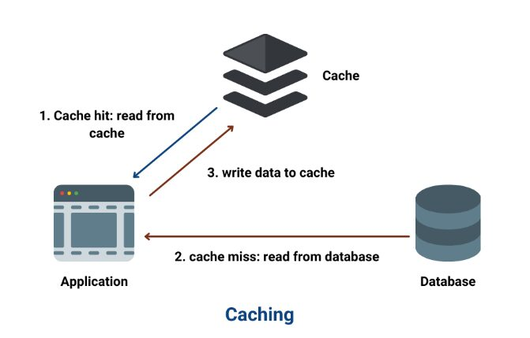

# Caching

[200lab.io/blog/caching-la-gi-cac-chien-luoc-caching-hieu-qua](https://200lab.io/blog/caching-la-gi-cac-chien-luoc-caching-hieu-qua?srsltid=AYCX9vLlqGoG1hSqnJHOe1KOmikk-7crUcVcGVC9t1tPb6qXOlOTLzOl)



## 1. Caching là gì?

**Caching (bộ nhớ đệm)** là kỹ thuật lưu trữ tạm thời những dữ liệu đã được truy xuất hoặc tính toán, giúp những lần sử dụng tiếp theo có thể lấy dữ liệu nhanh hơn mà không cần thực hiện lại toàn bộ quá trình ban đầu.

Hiểu đơn giản:

- **Không có cache:** Mỗi lần client gửi request, Backend phải truy vấn Database để lấy dữ liệu.
- **Có cache:** Backend kiểm tra xem dữ liệu đã được lưu trong cache chưa. Nếu có, nó lấy dữ liệu trực tiếp từ cache thay vì truy vấn Database.

Ví dụ trong một ứng dụng thương mại điện tử, 1.000 người cùng xem thông tin sản phẩm iPhone 17.

Nếu không có cache, hệ thống có thể phải thực hiện 1.000 truy vấn Database.

Nếu có cache, hệ thống có thể chỉ cần truy vấn Database một lần, lưu kết quả vào cache rồi phục vụ 999 request tiếp theo từ cache, giả sử dữ liệu chưa hết hạn và không bị xóa khỏi cache.

## 2. Luồng hoạt động khi sử dụng Caching

Giả sử ứng dụng Spring Boot sử dụng **Redis làm nơi lưu cache**.


Hai khái niệm cần nhớ:

- **Cache Hit:** Tìm thấy dữ liệu trong cache → lấy ngay.
- **Cache Miss:** Không tìm thấy dữ liệu → truy vấn Database, sau đó có thể lưu kết quả vào cache.

## 3. Vì sao cần sử dụng Caching?

Caching mang lại 4 lợi ích chính.

**1. Tăng tốc độ phản hồi (Reduce Latency)**
Thay vì truy vấn Database và xử lý lại dữ liệu, hệ thống có thể lấy kết quả từ bộ nhớ đệm, thường nhanh hơn đáng kể.

**2. Giảm tải Database (Reduce Database Load)**
Nhiều request cùng đọc một dữ liệu có thể được xử lý bằng cache, giảm số lượng SQL query.

**3. Tăng khả năng chịu tải (Scalability)**
Backend có thể phục vụ nhiều yêu cầu đọc hơn mà không cần tăng tài nguyên Database tương ứng.

**4. Tối ưu chi phí (Cost Optimization)**
Giảm tải công việc lặp lại, từ đó có thể hạn chế nhu cầu nâng cấp Database, dù bản thân cache cũng cần tài nguyên và chi phí vận hành.

## 4. Cache được lưu ở đâu? Application-level Cache vs Distributed Cache

Cache có thể được lưu tại nhiều vị trí khác nhau trong hệ thống, chẳng hạn như trình duyệt (Browser Cache), CDN, bộ nhớ ứng dụng hoặc một hệ thống cache riêng biệt.

Trong Backend Java, hai mô hình quan trọng cần nắm là:

- **Application-level Cache (Local Cache):** Cache được lưu trực tiếp trong bộ nhớ RAM của ứng dụng Backend.
- **Distributed Cache:** Cache được lưu trong một hệ thống riêng biệt, cho phép nhiều instance Backend sử dụng chung.

### 4.1. Application-level Cache (Local Cache)

Application-level Cache là mô hình lưu dữ liệu cache trực tiếp trong bộ nhớ của ứng dụng đang chạy.

Ví dụ, một ứng dụng Spring Boot sử dụng Caffeine để cache thông tin sản phẩm.


**Cách hoạt động:**

1. Client gửi request tới Spring Boot.
2. Backend kiểm tra Local Cache.
3. Nếu Cache Hit → trả dữ liệu ngay.
4. Nếu Cache Miss → truy vấn Database, lưu kết quả vào Local Cache và trả về Client.

**Ưu điểm:**

- Truy xuất rất nhanh vì dữ liệu nằm ngay trong RAM của ứng dụng.
- Không cần gọi mạng tới một cache server bên ngoài.
- Dễ triển khai, không cần cài đặt Redis.

**Nhược điểm:**

- Cache tiêu thụ RAM của ứng dụng.
- Cache thường mất khi ứng dụng restart.
- Khi có nhiều instance Backend, mỗi instance có cache riêng, dễ xuất hiện dữ liệu không đồng nhất.

**Ví dụ công nghệ:** Caffeine, Ehcache, ConcurrentHashMap (tự quản lý).

### 4.2. Distributed Cache

Distributed Cache là mô hình trong đó nhiều instance Backend cùng truy cập một hệ thống lưu trữ cache dùng chung.

Ví dụ, triển khai 3 instance Spring Boot cùng kết nối tới Redis.


**Cách hoạt động:**

1. Client gửi request tới Load Balancer.
2. Load Balancer chuyển request tới một instance Spring Boot.
3. Instance kiểm tra dữ liệu trong Redis.
4. Nếu Cache Hit → trả kết quả từ Redis.
5. Nếu Cache Miss → Backend truy vấn Database, lưu kết quả vào Redis, sau đó trả về Client.
6. Các instance khác có thể sử dụng lại dữ liệu vừa được cache.

**Ưu điểm:**

- Nhiều instance Backend có thể chia sẻ cache.
- Thuận tiện khi scale ứng dụng theo chiều ngang (Horizontal Scaling).
- Có thể quản lý cache tập trung, cấu hình TTL và giám sát riêng.
- Cache không bị mất chỉ vì một instance Backend restart.

**Nhược điểm:**

- Cần thêm hạ tầng như Redis.
- Có độ trễ mạng khi truy cập cache.
- Tốn chi phí RAM, triển khai và vận hành riêng.
- Nếu Redis gặp sự cố, nhiều instance có thể bị ảnh hưởng.

**Ví dụ công nghệ:** Redis, Memcached.

*Lưu ý:* Redis dùng chung không tự động đảm bảo dữ liệu luôn nhất quán với MySQL. Ứng dụng vẫn cần xử lý cập nhật hoặc xóa cache khi dữ liệu gốc thay đổi.

### 4.3. So sánh Application-level Cache và Distributed Cache

| Tiêu chí | Application-level Cache | Distributed Cache |
| --- | --- | --- |
| Vị trí | RAM của Backend | Cache server riêng |
| Truy xuất | Rất nhanh, không qua mạng | Có độ trễ mạng |
| Chia sẻ dữ liệu | Không mặc định chia sẻ | Nhiều instance dùng chung |
| Khi Backend restart | Thường mất cache | Cache vẫn tồn tại nếu Redis còn dữ liệu |
| Khả năng mở rộng | Khó đồng bộ giữa các instance | Phù hợp hệ thống nhiều instance |
| Độ phức tạp | Thấp | Cao hơn |
| Công nghệ | Caffeine, Ehcache | Redis, Memcached |

**Kết luận cần ghi nhớ:**

- Ứng dụng nhỏ, chạy một instance, dữ liệu ít thay đổi → ưu tiên Local Cache.
- Ứng dụng có nhiều instance Backend cần chia sẻ dữ liệu cache → cân nhắc Distributed Cache như Redis.
- Hệ thống lớn có thể kết hợp cả hai theo mô hình Multi-level Cache (L1 Local Cache + L2 Redis).

## 5. Khi nào nên Cache và khi nào KHÔNG nên Cache?

Không phải dữ liệu nào cũng nên cache. Việc sử dụng caching phụ thuộc vào **tần suất truy cập, mức độ thay đổi dữ liệu và yêu cầu về tính nhất quán.**

### 5.1. Khi nào NÊN Cache?

- **Dữ liệu được truy cập thường xuyên:** Thông tin sản phẩm, danh mục sản phẩm.
- **Dữ liệu ít thay đổi:** Danh sách tỉnh/thành phố, cấu hình hệ thống.
- **Dữ liệu tốn nhiều tài nguyên để tính toán:** Báo cáo doanh thu, thống kê, Dashboard.
- **Dữ liệu có thể chấp nhận độ trễ cập nhật:** Lượt xem bài viết, bảng xếp hạng.

**→ Mục đích:** Tăng tốc độ phản hồi API, giảm truy vấn Database và tối ưu tài nguyên hệ thống.

### 5.2. Khi nào KHÔNG nên Cache?

- **Dữ liệu yêu cầu tính nhất quán cao:** Số dư tài khoản, trạng thái giao dịch thanh toán.
- **Dữ liệu thay đổi liên tục:** Những dữ liệu khó đảm bảo cache luôn được cập nhật chính xác.
- **Dữ liệu ít được truy cập:** Cache không mang lại nhiều lợi ích.
- **Truy vấn Database đã đủ nhanh:** Không cần tăng thêm độ phức tạp nếu hiệu năng cải thiện không đáng kể.
- **Không có cơ chế Cache Invalidation:** Dễ trả về dữ liệu cũ (Stale Data).

**→ Lưu ý:** Dữ liệu yêu cầu tính nhất quán cao vẫn có thể được cache nếu có cơ chế phù hợp, nhưng không nên dùng cache cũ làm nguồn dữ liệu chính cho các quyết định quan trọng.

### 5.3. Bảng tổng hợp

| Nên Cache | Không nên Cache hoặc cần thận trọng |
| --- | --- |
| Đọc nhiều, ít thay đổi | Thay đổi liên tục |
| Tính toán phức tạp | Yêu cầu tính nhất quán cao |
| Truy vấn Database tốn tài nguyên | Truy vấn đã đủ nhanh |
| Dữ liệu được tái sử dụng nhiều | Dữ liệu ít được truy cập |
| Chấp nhận dữ liệu trễ cập nhật | Yêu cầu dữ liệu luôn mới nhất |

### 5.4. Những điều cần ghi nhớ khi thiết kế Caching

1. **Cache không thay thế Database:** Cache thường là lớp tối ưu giúp truy xuất dữ liệu nhanh hơn.
2. **Không phải dữ liệu nào cũng cần Cache:** Ưu tiên dữ liệu đọc nhiều, ít thay đổi hoặc tốn chi phí tính toán.
3. **Luôn quan tâm tính nhất quán (Cache Consistency):** Dữ liệu trong cache có thể khác dữ liệu gốc.
4. **Cần thiết lập TTL hoặc cơ chế Invalidation:** Tránh dữ liệu cũ tồn tại quá lâu.
5. **Cache cũng có chi phí:** RAM, hạ tầng, độ phức tạp và khả năng xảy ra lỗi.
6. **Đo trước và sau khi Cache:** Sử dụng response time, DB query count và Cache Hit Ratio để đánh giá hiệu quả.

T**óm tắt cuối cùng:** Caching không đơn giản là lưu dữ liệu vào Redis để tăng tốc. Thiết kế caching tốt đòi hỏi phải trả lời được 4 câu hỏi:

- Cache dữ liệu gì?
- Lưu cache ở đâu?
- Cache tồn tại trong bao lâu?
- Khi dữ liệu gốc thay đổi, làm thế nào để cache vẫn đáp ứng yêu cầu về tính chính xác?

## 6. Các chiến lược Caching (Caching Strategies)

Caching Strategies là những cách tổ chức **luồng đọc, ghi và đồng bộ dữ liệu giữa Application, Cache và Database.**

Có 4 chiến lược phổ biến cần nắm vững:

1. **Cache-Aside (Lazy Loading):** Ứng dụng chủ động đọc và cập nhật cache khi cần.
2. **Read-Through:** Cache tự xử lý việc lấy dữ liệu từ Database khi Cache Miss.
3. **Write-Through:** Dữ liệu được ghi vào Cache và Database đồng bộ.
4. **Write-Behind (Write-Back)**: Dữ liệu được ghi vào Cache trước, sau đó mới ghi xuống Database bất đồng bộ.

### 6.1. Cache-Aside (Lazy Loading)

Đây là chiến lược phổ biến, phù hợp với các ứng dụng **Java Spring Boot** sử dụng **Redis và MySQL.**

**Nguyên lý:** Application chủ động kiểm tra cache. Nếu không có dữ liệu, Application truy vấn Database rồi lưu kết quả vào cache.


**Luồng ghi:** Khi cập nhật dữ liệu, Application ghi vào Database, sau đó xóa cache liên quan (Cache Invalidation) để lần đọc tiếp theo lấy dữ liệu mới.

**Ưu điểm:**

- Chỉ cache dữ liệu được truy cập.
- Tiết kiệm bộ nhớ cache.
- Dễ triển khai với Spring Boot và Redis.

**Nhược điểm:**

- Cache Miss khiến request đầu tiên chậm hơn.
- Có thể xảy ra Stale Data nếu không xử lý cache invalidation.
- Cần giải quyết vấn đề nhiều request đồng thời cùng Cache Miss.

**Ví dụ:** Cache thông tin sản phẩm, danh mục, thông tin người dùng.

### 6.2. Read-Through

**Nguyên lý:** Application chỉ yêu cầu dữ liệu từ hệ thống Cache. Khi Cache Miss, **lớp Cache/Cache Provider** chịu trách nhiệm tự lấy dữ liệu từ Database rồi lưu lại.


**Ưu điểm:**

- Application không phải tự xử lý logic Cache Miss.
- Logic đọc dữ liệu tập trung tại Cache Layer.

**Nhược điểm:**

- Phụ thuộc vào cơ chế Data Loader của hệ thống cache.
- Cache Miss vẫn có độ trễ truy vấn Database.

**Ví dụ:** Cache Provider có hỗ trợ tự tải dữ liệu; Caffeine với cơ chế LoadingCache.

**Phân biệt:** Redis thông thường không tự truy vấn MySQL. Muốn triển khai Read-Through với Redis phải có một lớp tích hợp hoặc Data Loader phù hợp.

### 6.3. Write-Through

**Nguyên lý:** Mỗi khi cập nhật dữ liệu, hệ thống ghi vào Cache và Database một cách đồng bộ. Request chỉ hoàn tất khi thao tác ghi cần thiết đã thành công.


**Ưu điểm:**

- Cache được cập nhật khi ghi dữ liệu.
- Giảm nguy cơ đọc phải dữ liệu cache cũ sau khi cập nhật thành công.

**Nhược điểm:**

- Ghi chậm hơn vì phải thao tác trên cả Cache và Database.
- Phải xử lý trường hợp chỉ một trong hai nơi ghi thành công.

**Ví dụ:** Các hệ thống thường xuyên đọc lại dữ liệu ngay sau khi cập nhật.

### 6.4. Write-Behind (Write-Back)

**Nguyên lý:** Dữ liệu được ghi vào Cache trước. Sau đó, hệ thống ghi xuống Database theo cơ chế bất đồng bộ, có thể ghi theo lô (Batch).


**Ưu điểm:**

- Phản hồi thao tác ghi nhanh.
- Có thể gom nhiều lần ghi thành một Batch để giảm tải Database.

**Nhược điểm:**

- Database chưa được cập nhật ngay (Eventual Consistency).
- Có nguy cơ mất dữ liệu nếu Cache hoặc hàng đợi ghi gặp sự cố.
- Cần cơ chế retry, persistence và xử lý lỗi phù hợp.

**Ví dụ:** Dữ liệu đo lường, thống kê, hệ thống có nhiều thao tác ghi và chấp nhận cập nhật Database trễ.

### 6.5. Bảng so sánh các chiến lược Caching

| Chiến lược | Luồng đọc/ghi chính | Ưu điểm | Nhược điểm |
| --- | --- | --- | --- |
| **Cache-Aside** | App kiểm tra Cache, Miss thì đọc DB | Linh hoạt, tiết kiệm cache | Miss chậm, cần invalidation |
| **Read-Through** | Cache Layer tự tải dữ liệu khi Miss | Đơn giản hóa Application | Cần cơ chế Data Loader |
| **Write-Through** | Ghi Cache và DB đồng bộ | Giảm nguy cơ dữ liệu cũ | Ghi chậm, có thể lỗi một phần |
| **Write-Behind** | Ghi Cache trước, DB sau | Ghi nhanh, hỗ trợ batch | Có nguy cơ mất dữ liệu |

### 6.6. Nên sử dụng chiến lược nào trong Spring Boot?

Với dự án **Spring Boot + Redis + MySQL**, nên bắt đầu bằng **Cache-Aside** kết hợp **Cache Invalidation.**

Ví dụ trong ProductService:

```jsx
@Service
public class ProductService {
    private final ProductRepository repository;

    public ProductService(ProductRepository repository) {
        this.repository = repository;
    }

    @Cacheable(value = "products", key = "#id")
    public Product getProduct(Long id) {
        return repository.findById(id)
                .orElseThrow();
    }

    @CacheEvict(value = "products", key = "#id")
    public void deleteProduct(Long id) {
        repository.deleteById(id);
    }
}
```

Với caching được bật và RedisCacheManager được cấu hình:

- `@Cacheable`: Kiểm tra cache trước. Nếu không có dữ liệu thì gọi phương thức và cache kết quả.
- `@CacheEvict`: Sau khi phương thức xóa thành công, xóa entry tương ứng khỏi cache.

Đây là ví dụ cơ bản; trong ứng dụng thực tế còn cần xử lý transaction, cập nhật dữ liệu và các request đồng thời để tránh sai lệch cache.

**Lưu ý quan trọng:** Các chiến lược này không hoàn toàn loại trừ nhau. Cache-Aside và Read-Through chủ yếu mô tả *cách đọc*, còn Write-Through và Write-Behind chủ yếu mô tả *cách ghi*. Một hệ thống có thể kết hợp các chiến lược phù hợp.