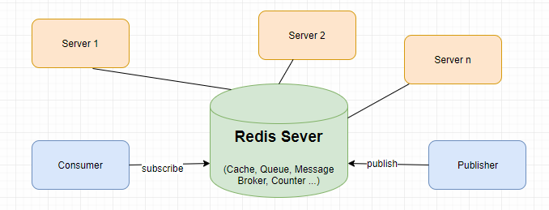

# Redis

[https://redis.io/tutorials/what-is-redis/](https://redis.io/tutorials/what-is-redis/)

[https://200lab.io/blog/redis-la-gi](https://200lab.io/blog/redis-la-gi?srsltid=AYCX9vKWn8TlVwIP2glqTli8I-AFI8aiFLwJsRx66iEQd3mci87pDL9i)

[https://docs.google.com/document/d/1DM3Nq9lHK1_fQWgwooxvRPyZwzG6IgPnW_1aim01jVM/edit?tab=t.0](https://docs.google.com/document/d/1DM3Nq9lHK1_fQWgwooxvRPyZwzG6IgPnW_1aim01jVM/edit?tab=t.0)



## 1. Redis là gì? Vì sao cần sử dụng Redis?

### 1.1. Redis là gì?

**Redis (Remote Dictionary Server)** là một hệ thống lưu trữ dữ liệu dạng **Key-Value**, thuộc nhóm NoSQL Database, có đặc điểm nổi bật là lưu trữ và xử lý dữ liệu chủ yếu trên **RAM (In-Memory)** thay vì đọc trực tiếp từ ổ đĩa.

Nhờ đó, Redis có tốc độ truy xuất rất nhanh và thường được sử dụng để làm Cache, lưu Session, Rate Limiting và xử lý dữ liệu thời gian thực.

[](https://www.google.com/s2/favicons?domain=https://redis.io&sz=32)


Ví dụ sử dụng Redis CLI:

```jsx
# Lưu dữ liệu
SET user:1:name "Nguyen Van A"

# Lấy dữ liệu
GET user:1:name
# "Nguyen Van A"

# Lưu dữ liệu với TTL 60 giây
SET product:1 "iPhone 17" EX 60

# Xóa dữ liệu
DEL user:1:name
```

Redis không chỉ lưu String mà còn hỗ trợ các kiểu dữ liệu như Hash, List, Set, Sorted Set và Stream.

### 1.2. Vì sao cần sử dụng Redis?

**1. Tăng tốc độ truy xuất dữ liệu**

Redis lưu dữ liệu chủ yếu trong RAM nên có thể truy xuất rất nhanh, thường đạt độ trễ dưới 1 ms trong điều kiện phù hợp.

Ví dụ:

- Không Redis: Backend thường xuyên truy vấn MySQL.
- Có Redis: Backend có thể lấy dữ liệu trực tiếp từ RAM của Redis.

**2. Giảm tải Database**

Khi nhiều người dùng cùng truy cập một dữ liệu, Redis có thể phục vụ phần lớn các request mà không cần truy vấn MySQL lặp lại.

**3.** **Chia sẻ dữ liệu giữa nhiều Backend Instance**

Redis chạy như một dịch vụ riêng, cho phép nhiều instance Spring Boot cùng truy cập dữ liệu.

Điều này đặc biệt hữu ích trong các hệ thống có Load Balancer, Microservices hoặc Horizontal Scaling.

**4. Hỗ trợ nhiều bài toán ngoài Caching**

Redis còn được sử dụng cho:

- **Session Storage:** Lưu thông tin phiên đăng nhập.
- **Rate Limiting:** Giới hạn số request đến API.
- **Leaderboard:** Xây dựng bảng xếp hạng.
- **Counter:** Đếm lượt truy cập, số lần thực hiện hành động.
- **Pub/Sub:** Truyền thông điệp giữa các thành phần hệ thống.

### 1.3. Luồng hoạt động của Redis với Spring Boot và MySQL

Đây là kiến trúc phổ biến khi dùng Redis làm Distributed Cache.


**Các bước hoạt động:**

1. Client gửi request tới Spring Boot.
2. Spring Boot kiểm tra dữ liệu trong Redis.
3. Nếu Cache Hit → lấy dữ liệu từ Redis và trả về Client.
4. Nếu Cache Miss → truy vấn Database, lưu kết quả vào Redis rồi trả về Client.
5. Các request sau có thể sử dụng lại dữ liệu đã được cache.

**Lưu ý:** Redis không tự động kết nối hoặc đồng bộ dữ liệu với MySQL trong mô hình này. Spring Boot chịu trách nhiệm điều phối dữ liệu giữa hai hệ thống.

### 1.4. Redis khác gì MySQL?

| Tiêu chí | Redis | MySQL |
| --- | --- | --- |
| Loại Database | NoSQL | Relational Database |
| Cách lưu dữ liệu | Chủ yếu trên RAM | Chủ yếu trên ổ đĩa, có bộ nhớ đệm |
| Cấu trúc | Key-Value với nhiều kiểu dữ liệu | Table, Row, Column |
| Truy vấn | GET, SET, HGET... | SQL |
| Điểm mạnh | Truy xuất nhanh, xử lý dữ liệu thời gian thực | Quan hệ dữ liệu, giao dịch, tính toàn vẹn |
| Ứng dụng phổ biến | Cache, Session, Rate Limiting | Lưu dữ liệu nghiệp vụ chính |

Trong nhiều hệ thống Spring Boot:

- MySQL: Lưu dữ liệu chính (Source of Truth).
- Redis: Lưu dữ liệu tạm để cải thiện hiệu năng.

Tuy nhiên, Redis cũng có thể được sử dụng như một Database độc lập trong những trường hợp phù hợp, không chỉ để làm cache.

### 1.5. Redis lưu dữ liệu trên RAM thì khi tắt có mất không?

**Không nhất thiết.** Redis hỗ trợ các cơ chế Persistence để lưu dữ liệu xuống ổ đĩa.


- **RDB (Redis Database):** Lưu snapshot tại từng thời điểm. Có nguy cơ mất các thay đổi chưa được lưu.
- **AOF (Append Only File):** Ghi lại các thao tác thay đổi dữ liệu, cho phép phục hồi bằng cách phát lại log.
- **Không bật Persistence:** Dữ liệu chỉ tồn tại trong bộ nhớ và có thể mất khi Redis dừng hoặc restart.

Có thể sử dụng đồng thời RDB và AOF.

### 1.6. Khi nào nên sử dụng Redis?

| Trường hợp | Có nên dùng Redis? |
| --- | --- |
| Cache sản phẩm, danh mục | Nên |
| Chia sẻ session giữa nhiều Backend | Nên cân nhắc |
| API Rate Limiting | Nên |
| Counter, Leaderboard | Nên |
| Ứng dụng nhỏ, truy vấn DB đã nhanh | Chưa cần thiết |
| Lưu giao dịch tài chính chính | Không nên dùng Redis cache làm nguồn dữ liệu có thẩm quyền |

Redis rất nhanh nhưng không phải lúc nào cũng cần thiết. Việc thêm Redis cũng làm tăng chi phí RAM, hạ tầng và độ phức tạp của hệ thống.

### 1.7. Tổng kết kiến thức cần ghi nhớ

- Redis là hệ thống lưu trữ dữ liệu **In-Memory, Key-Value, NoSQL.**
- Redis thường được dùng làm **Distributed Cache** trong ứng dụng Backend.
- Redis giúp tăng tốc truy xuất, giảm tải Database và chia sẻ dữ liệu giữa các Backend instance.
- Redis không chỉ dùng để cache mà còn hỗ trợ Session, Rate Limiting, Counter, Pub/Sub...
- Redis có thể lưu dữ liệu xuống ổ đĩa thông qua **RDB và AOF.**
- Redis không mặc định tự đồng bộ dữ liệu với MySQL.

**Kết luận:** Trong hệ thống Java Spring Boot + MySQL, Redis thường đóng vai trò là một lớp lưu trữ dữ liệu tốc độ cao. MySQL giữ dữ liệu nghiệp vụ chính, còn Redis giúp hạn chế những truy vấn và thao tác lặp lại không cần thiết.

## 2. Redis Data Types – Các kiểu dữ liệu trong Redis

Redis không chỉ lưu dữ liệu dạng String mà còn hỗ trợ nhiều cấu trúc dữ liệu khác nhau. Mỗi kiểu được tối ưu cho một nhóm thao tác và bài toán cụ thể.

Trong Java Backend, nên nắm chắc **5 kiểu dữ liệu cơ bản: String, Hash, List, Set, Sorted Set**, sau đó tìm hiểu thêm Stream.

### 2.1. String

**String** là kiểu dữ liệu đơn giản nhất trong Redis, dùng để lưu chuỗi ký tự, số hoặc dữ liệu nhị phân.

Một String value có thể chứa tối đa 512 MB theo cấu hình mặc định.


Các lệnh cơ bản:

```
SET product:1:price 20000000
GET product:1:price
# "20000000"

SET views:post:1 100
INCR views:post:1
# 101
```

**Ứng dụng:** Cache API response, lưu giá trị đơn giản, đếm lượt xem, lưu mã xác thực tạm thời.

*Lưu ý:* String cũng có thể lưu một đối tượng Java đã được serialize thành JSON.

### 2.2. Hash

**Hash** lưu dữ liệu dưới dạng tập hợp các cặp `field-value`, tương tự `HashMap` trong Java.

Phù hợp khi muốn lưu một đối tượng có nhiều thuộc tính.


Các lệnh cơ bản:

```
HSET user:1 name "Nguyen Van A" age 21 city "Ha Noi"

HGET user:1 name
# "Nguyen Van A"

HGETALL user:1
# Trả về toàn bộ field-value

HDEL user:1 city
# Xóa field city
```

**Ứng dụng:** Lưu thông tin người dùng, thông tin sản phẩm, giỏ hàng đơn giản.

**Điểm khác với String:** Hash cho phép truy cập và cập nhật từng field mà không cần thay thế toàn bộ đối tượng.

### 2.3. List

**List** là danh sách có thứ tự, cho phép thêm và lấy phần tử ở đầu hoặc cuối danh sách.

Có thể chứa các giá trị trùng lặp.


Các lệnh cơ bản:

```
LPUSH tasks "Task A"
LPUSH tasks "Task B"
LPUSH tasks "Task C"

LRANGE tasks 0 -1
# Task C, Task B, Task A

LPOP tasks
# "Task C"

RPUSH tasks "Task D"
# Thêm Task D vào cuối danh sách
```

**Ứng dụng:** Danh sách công việc, hàng đợi đơn giản, lịch sử hoạt động gần đây.

Đối với hệ thống hàng đợi phức tạp, cần retry và xác nhận xử lý, có thể cân nhắc Redis Streams thay vì chỉ sử dụng List.

### 2.4. Set

**Set** là tập hợp các phần tử không trùng lặp và không đảm bảo thứ tự.

Tương tự `HashSet` trong Java.


Các lệnh cơ bản:

```
SADD online:users user:1 user:2 user:3
SADD online:users user:1
# Không thêm phần tử trùng lặp

SMEMBERS online:users
# Lấy danh sách phần tử (không đảm bảo thứ tự)

SISMEMBER online:users user:2
# 1 = tồn tại

SREM online:users user:3
```

**Ứng dụng:** Lưu danh sách người dùng online, danh sách tag, loại bỏ phần tử trùng lặp, kiểm tra tư cách thành viên của một nhóm.

### 2.5. Sorted Set (ZSet)

**Sorted Set** tương tự Set nhưng mỗi phần tử có thêm một giá trị Score, dùng để sắp xếp.

- Không cho phép Member trùng lặp.
- Mỗi Member gắn với một Score.
- Mặc định sắp xếp theo Score tăng dần.


Các lệnh cơ bản:

```
ZADD leaderboard 100 player:C
ZADD leaderboard 300 player:A
ZADD leaderboard 200 player:B

ZRANGE leaderboard 0 -1
# player:C, player:B, player:A

ZREVRANGE leaderboard 0 -1 WITHSCORES
# player:A 300, player:B 200, player:C 100

ZINCRBY leaderboard 50 player:C
# Tăng điểm player:C thêm 50
```

**Ứng dụng:** Leaderboard, ranking, priority queue và sliding-window rate limiting.

### 2.6. Stream (Tìm hiểu thêm)

**Stream** là cấu trúc dữ liệu dạng append-only log, phù hợp để lưu và xử lý chuỗi sự kiện (Events).


```
XADD orders * orderId 101 status created

XRANGE orders - +
# Đọc các sự kiện đã lưu
```

**Ứng dụng:** Event processing, message queue, giao tiếp bất đồng bộ giữa các service.

Redis Streams hỗ trợ Consumer Groups để phân phối sự kiện cho nhiều consumer.

### 2.7. Bảng tổng hợp Redis Data Types

| Data Type | Đặc điểm | Trường hợp sử dụng |
| --- | --- | --- |
| String | Một giá trị | Cache, Counter |
| Hash | Field–Value | User, Product |
| List | Có thứ tự, cho phép trùng | Queue, History |
| Set | Không thứ tự, không trùng | Tags, Unique Users |
| Sorted Set | Không trùng, có Score | Leaderboard, Ranking |
| Stream | Chuỗi sự kiện | Event Processing |

Ngoài ra, Redis còn có các kiểu dữ liệu và khả năng chuyên biệt như Bitmap, HyperLogLog, Geospatial, JSON...

**Ghi nhớ:** Chọn Redis Data Type dựa trên **cách ứng dụng cần truy cập và thao tác với dữ liệu**, không chỉ dựa vào kiểu dữ liệu trong Java.

## 3. Các lệnh Redis CLI cơ bản

### 3.1. Redis CLI là gì?

**Redis CLI (Command Line Interface)** là công cụ dòng lệnh cho phép tương tác trực tiếp với Redis Server.

Thông qua Redis CLI, bạn có thể:

- Thêm, đọc, cập nhật, xóa dữ liệu.
- Quản lý thời gian tồn tại của Key (TTL).
- Kiểm tra kiểu dữ liệu và trạng thái Redis.
- Thực hành các Redis Data Types.

#### Luồng hoạt động


Nếu chạy Redis bằng Docker:

```jsx
docker run -d --name redis -p 6379:6379 redis:7

docker exec -it redis redis-cli
```

Sau đó có thể nhập các lệnh Redis trực tiếp. Container này phục vụ thực hành, chưa cấu hình lưu trữ bền vững; không nên mở Redis ra mạng công cộng khi chưa thiết lập bảo mật.

### 3.2. Các lệnh quản lý Key

Các lệnh này có thể sử dụng với hầu hết Redis Data Types.

| Lệnh | Chức năng |
| --- | --- |
| `EXISTS key` | Kiểm tra Key tồn tại |
| `DEL key` | Xóa Key |
| `TYPE key` | Xem kiểu dữ liệu |
| `RENAME key newkey` | Đổi tên Key |
| `SCAN cursor MATCH pattern` | Duyệt Key theo từng phần |
| `EXPIRE key seconds` | Thiết lập thời gian hết hạn |
| `TTL key` | Kiểm tra thời gian còn lại |
| `PERSIST key` | Xóa thời gian hết hạn |

Ví dụ:

```
SET product:1 "Laptop"

EXISTS product:1
# 1: tồn tại

TYPE product:1
# string

RENAME product:1 product:100

DEL product:100
# 1: xóa thành công
```

Lưu ý: Không nên sử dụng `KEYS *` để quét toàn bộ Key trong môi trường Production vì có thể ảnh hưởng hiệu năng. Ưu tiên `SCAN`.

### 3.3. Các lệnh String

| Lệnh | Chức năng |
| --- | --- |
| `SET` | Lưu giá trị |
| `GET` | Đọc giá trị |
| `MSET` | Lưu nhiều Key |
| `MGET` | Đọc nhiều Key |
| `INCR` | Tăng giá trị thêm 1 |
| `DECR` | Giảm giá trị đi 1 |
| `INCRBY` | Tăng theo số lượng |
| `APPEND` | Nối thêm chuỗi |

```
SET name "Redis"
GET name
# "Redis"

MSET product:1 "Laptop" product:2 "Mouse"
MGET product:1 product:2

SET counter 10
INCR counter
# 11

INCRBY counter 5
# 16

DECR counter
# 15
```

Lệnh `INCR` và `INCRBY` thực hiện phép tăng một cách atomic, rất hữu ích khi nhiều request cùng cập nhật bộ đếm.

### 3.4. Các lệnh Hash

| Lệnh | Chức năng |
| --- | --- |
| `HSET` | Thêm hoặc sửa Field |
| `HGET` | Đọc một Field |
| `HGETALL` | Đọc toàn bộ Hash |
| `HDEL` | Xóa Field |
| `HEXISTS` | Kiểm tra Field |
| `HINCRBY` | Tăng giá trị Field |

```
HSET user:1 name "An" age 20

HGET user:1 name
# "An"

HINCRBY user:1 age 1
# 21

HEXISTS user:1 email
# 0

HGETALL user:1
```

### 3.5. Các lệnh List, Set và Sorted Set

| Kiểu | Lệnh | Chức năng |
| --- | --- | --- |
| List | `LPUSH` | Thêm vào đầu |
| List | `RPUSH` | Thêm vào cuối |
| List | `LPOP` | Lấy và xóa đầu |
| List | `LRANGE` | Đọc một khoảng |
| Set | `SADD` | Thêm phần tử |
| Set | `SMEMBERS` | Lấy các phần tử |
| Set | `SISMEMBER` | Kiểm tra phần tử |
| Set | `SREM` | Xóa phần tử |
| Sorted Set | `ZADD` | Thêm Member và Score |
| Sorted Set | `ZRANGE` | Đọc theo thứ hạng tăng dần |
| Sorted Set | `ZREVRANGE` | Đọc thứ hạng giảm dần |
| Sorted Set | `ZINCRBY` | Tăng Score |

Ví dụ:

```
# List
RPUSH tasks task1 task2 task3
LRANGE tasks 0 -1
LPOP tasks

# Set
SADD tags java spring redis
SMEMBERS tags
SISMEMBER tags java

# Sorted Set
ZADD ranking 100 user1 200 user2
ZREVRANGE ranking 0 -1 WITHSCORES
```

### 3.6. TTL và Expiration – Quản lý thời gian tồn tại

Đây là phần **đặc biệt quan trọng khi học Redis Caching.**

**TTL (Time To Live)** là thời gian một Key còn tồn tại trước khi Redis tự động cho Key đó hết hạn.

Ví dụ, muốn cache thông tin sản phẩm trong 60 giây:

```
SET product:1 "Laptop" EX 60
```


Các lệnh quan trọng:

```
SET product:1 "Laptop"

EXPIRE product:1 60
# Đặt TTL = 60 giây

TTL product:1
# Số giây còn lại

PERSIST product:1
# Xóa TTL, Key không tự hết hạn

TTL product:1
# -1
```

Giá trị trả về của `TTL`:

| Kết quả | Ý nghĩa |
| --- | --- |
| Số nguyên không âm | Số giây còn lại |
| `-1` | Key tồn tại nhưng không có TTL |
| `-2` | Key không tồn tại |

Lưu ý, lệnh `SET` thông thường ghi đè giá trị và xóa TTL cũ, trừ khi dùng tùy chọn phù hợp như `KEEPTTL`.

### 3.7. Các lệnh kiểm tra Redis Server

| Lệnh | Chức năng |
| --- | --- |
| `PING` | Kiểm tra kết nối |
| `INFO` | Xem thông tin Redis Server |
| `DBSIZE` | Đếm số Key trong Database hiện tại |
| `MEMORY USAGE key` | Kiểm tra bộ nhớ Key sử dụng |
| `CLIENT LIST` | Liệt kê các kết nối |
| `SLOWLOG GET` | Kiểm tra các lệnh chậm đã được ghi nhận |

Ví dụ:

```
PING
# PONG

DBSIZE
# Số key hiện có

INFO memory
# Thống kê bộ nhớ Redis

MEMORY USAGE product:1
# Số byte bộ nhớ được sử dụng
```